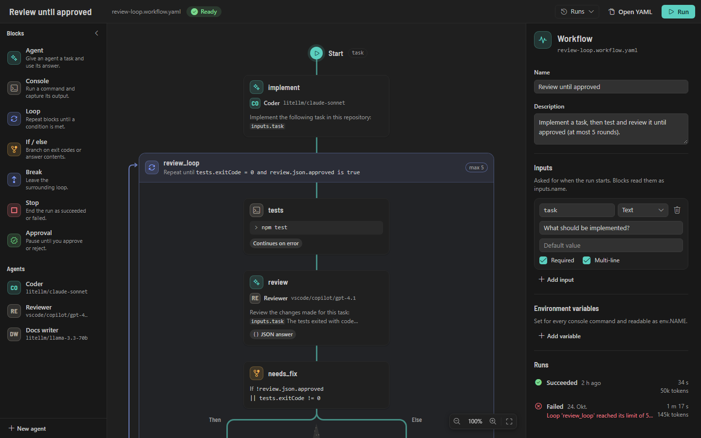
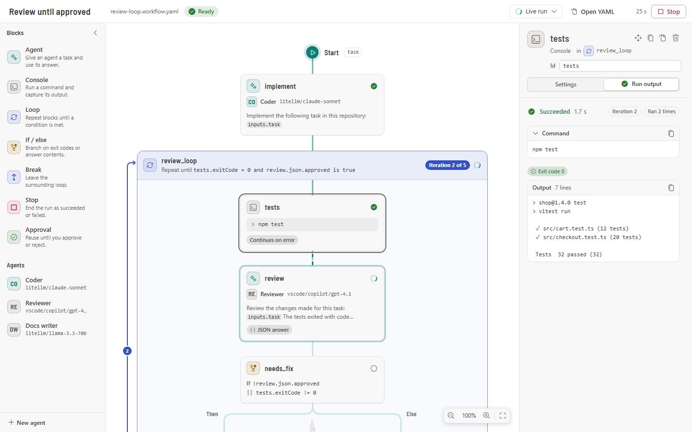
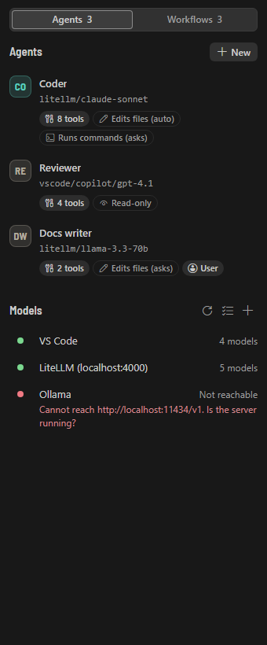
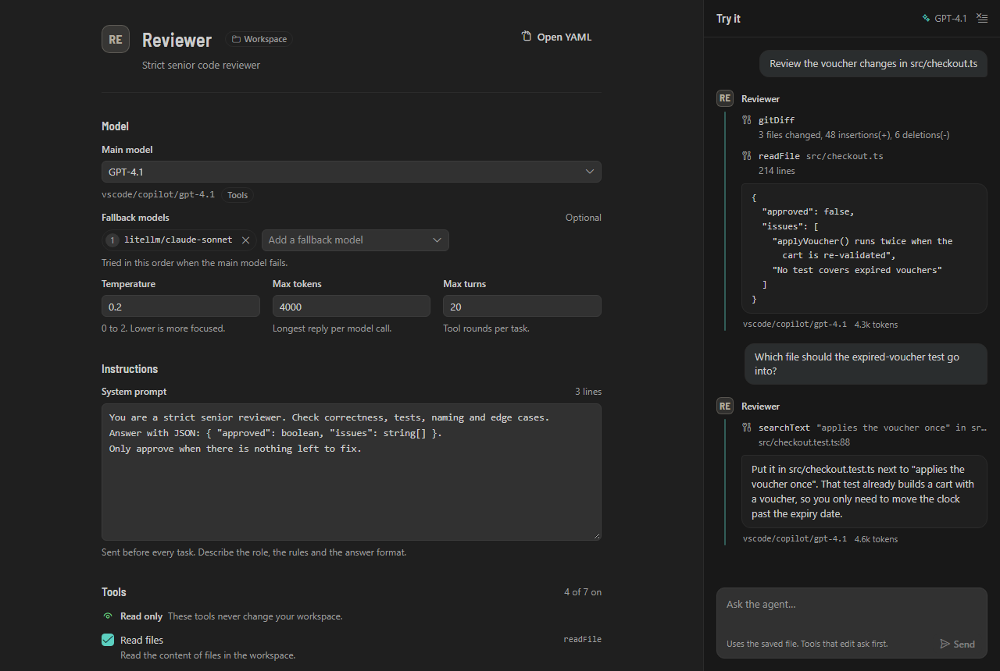

# Isar Flow

Isar Flow is a VS Code extension for configuring AI agents and chaining them into workflows. A workflow is a
YAML file made of blocks: agents that read and edit your code, console commands, loops, conditions and
human approvals. You build it on a visual canvas, the river, or write the YAML by hand; both are views of the
same file and stay in sync, comments included. Agents use the models VS Code offers, such as GitHub Copilot,
or any OpenAI-compatible endpoint: LiteLLM, Ollama, vLLM, OpenRouter. Runs happen inside VS Code with live
status on the canvas, console output in a terminal and a history of past runs.



## Features

- **River editor**: blocks sit on a vertical stream; If / else splits it into lanes, a loop draws a return
  channel. Add blocks from the palette or the **+** between blocks, drag them around or use **Move to…** and
  the keyboard. Every visual edit rewrites only the changed part of the YAML.
- **Seven blocks**: Agent, Console, Loop (until, while or a fixed number of times), If / else, Break, Stop and
  Approval.
- **Expressions**: `${{ steps.tests.exitCode == 0 }}`, `${{ tail(steps.tests.output, 80) }}` and 16 more
  functions, or conditions built from rules without writing an expression.
- **Agents** with a model, fallback models, a system prompt, built-in tools (read, list and search files,
  git diff, edit files, apply patches, write files, run commands) and per-agent permissions: never, ask or
  always. Badges show at a glance whether an agent is read-only, edits files or runs commands. **Try it**
  chats with an agent before you put it into a workflow.
- **Review every change**: after a run, a review card lists the files it changed, with the block that changed
  each one and a diff. Keep or revert each file; reverts restore the file byte for byte. In a git repository
  a snapshot before and after each run covers console commands too, without touching your index or branch.
  Workflows can also run on a separate git worktree (`isolation: worktree`) and only touch your files when
  you keep a change.
- **Made for local models**: `applyPatch` and a tolerant `editFile` that forgive whitespace and line-ending
  slips, tool calls written as text for models without native tool calling (`toolMode`), and long
  conversations summarized before they outgrow the context. **Test model** and **Check setup** tell you
  whether an endpoint and its models work, and how to fix them.
- **Time and tokens**: every block shows its time, tokens and (with `isarFlow.modelPrices`) cost; the run
  summary has a table per block and averages over the last 20 runs.
- **JSON answers**: describe the shape (`{ approved: boolean, issues: "string[]" }`) and later blocks read
  `steps.review.json.approved`. Answers that do not fit get one repair round.
- **Models**: VS Code language models and OpenAI-compatible endpoints with model discovery, API keys in
  VS Code's secret storage, retries and fallback models.
- **Live runs**: block status and loop iterations on the canvas, rendered prompts and outputs in the
  inspector, console output mirrored to a terminal, inline approvals, a run history.
- **Build faster**: **Run from here** continues a finished run at any block and reuses the results before it,
  even inside a loop, and warns when blocks changed since. **Live values** show what a `${{ … }}` template
  evaluated to in the last run when you hover it on the canvas, in the inspector or in the YAML editor.
  **Simulate** runs a workflow with mocks from a `.sim.yaml` file, edited in the inspector: no commands, no
  model calls, no file changes, so you can test loops and conditions in seconds, even in Restricted Mode.
- **Safety**: runs need a trusted workspace, console commands are confirmed before they run, agent tools stay
  inside the workflow's folder, every change can be reviewed and reverted, loops need a limit, and an optional
  token budget stops expensive runs.



## Quick start

1. **Install** the extension from a `.vsix` file: in VS Code run **Extensions: Install from VSIX…** and pick
   `isar-flow-0.1.0.vsix` (or `code --install-extension isar-flow-0.1.0.vsix`). See
   [Development](#development) to build the file yourself.
2. **Open the sidebar**: open a folder and select the Isar Flow icon in the Activity Bar.
3. **Add a LiteLLM endpoint**: start your proxy (`litellm --config config.yaml`, port 4000). Under
   **Models**, select **+** (or run **Isar Flow: Add model endpoint**), choose **LiteLLM**, keep the id
   `litellm` and the URL `http://localhost:4000`, and enter your LiteLLM key. Your models appear as
   `litellm/<model_name>`. With GitHub Copilot installed you can skip this step and use its models.
4. **Create the review loop**: on the **Workflows** tab select **New**, name it and pick **Review loop**.
   Isar Flow also creates the agents `coder` and `reviewer` if they are missing. Open each agent from the
   **Agents** tab and pick a model, for example `litellm/gpt-4.1`.
5. **Run**: in the workflow, select the `tests` block and replace `npm test` with your test command. Select
   **Run**, describe the task and confirm the commands. Watch the blocks light up; the loop repeats until
   the tests pass and the reviewer approves (at most 5 rounds).

To try the loop without models first, select the arrow next to **Run** and choose **Simulate**. Nothing runs:
every block gets a mocked result. Copy the [example mocks](examples/.isarflow/simulations/review-loop.sim.yaml)
to `.isarflow/simulations/<workflow file name>.sim.yaml` to see the tests fail once and the reviewer approve
in round 2.

The [user guide](docs/user-guide.md) explains every block, expressions, agents, models, runs, reviewing
changes, Run from here, live values, test mode and security in detail. The [examples](examples/) folder has
ready-made workflows, agents and simulation mocks.

<p>
  
  
</p>

## Development

Requirements: Node 20 or later (developed on Node 24) and npm.

```bash
npm install
npm run build            # webview bundle (Vite) + extension bundle (esbuild)
npm test                 # unit, contract, host and component tests (Vitest)
npm run test:coverage    # the same with the coverage gate: core ≥ 90 %, extension ≥ 70 % of lines
npm run typecheck
npm run lint
npm run test:integration # builds, then runs the extension in a downloaded VS Code
npm run test:visual      # screenshots of every webview in dark, light and high contrast
npm run package          # builds and writes packages/extension/isar-flow-<version>.vsix
```

Open the repository in VS Code and press `F5` (**Run Isar Flow**) to build and start an Extension
Development Host; **Run Isar Flow (fixture workspace)** opens it on the test fixture workspace.

| Package               | Contents                                                                                                                                                                                                                                |
| --------------------- | --------------------------------------------------------------------------------------------------------------------------------------------------------------------------------------------------------------------------------------- |
| `packages/core`       | Isomorphic TypeScript without `vscode` imports: schemas, YAML parsing and comment-preserving edits, expressions, conditions, validation, the workflow engine, the agent runtime, the OpenAI-compatible client and the webview protocol. |
| `packages/extension`  | The VS Code extension: sidebar and custom editors, model registry, console runner, agent tool host, run manager, history. Bundled with esbuild.                                                                                         |
| `packages/webview-ui` | React webviews (sidebar, river editor, agent editor) built with Vite, plus a browser harness with a mock host for screenshots.                                                                                                          |

**Tests** follow the test concept in [§11 of the design spec](docs/superpowers/specs/2026-10-25-isar-flow-design.md#11-test-concept):
TDD for core and host logic; Vitest unit tests for the core (expressions, conditions, schemas, YAML edits
with golden comment-preserving fixtures, validation, engine, agent runtime); contract tests of the
OpenAI-compatible client against a local mock server; host tests that run real processes for the console
runner and check path guarding of agent tools; component tests of the webviews with Testing Library;
integration tests in a real VS Code with `@vscode/test-electron`; and Playwright screenshots of every
webview in three themes for visual review. Fakes (a scripted model, a fake engine host, a mock OpenAI
server) are preferred over mocks, and every bug fix starts with a regression test.

Design documents: [design spec](docs/superpowers/specs/2026-10-25-isar-flow-design.md),
[UI brief](docs/ui-design.md), [implementation plan](docs/superpowers/plans/2026-10-25-isar-flow.md).

## License

[MIT](LICENSE)
