# Isar Flow user guide

Isar Flow lets you configure AI agents and chain them, together with console commands, loops, conditions
and approvals, into workflows that run inside VS Code. A workflow is a YAML file; the river editor and the
YAML text are two views of the same file and stay in sync.

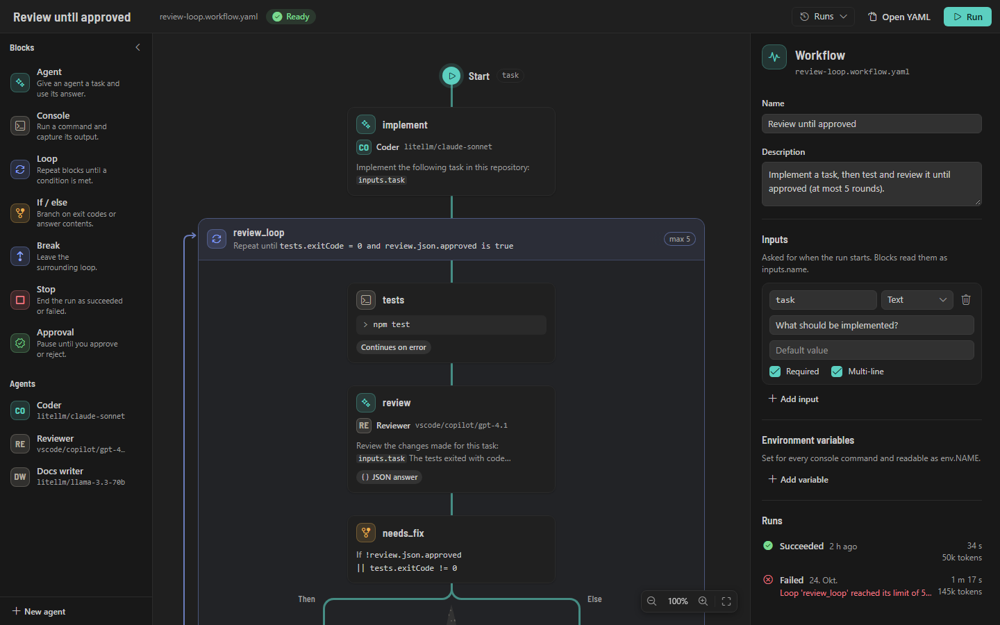

## Contents

1. [Concepts](#1-concepts)
2. [Getting started](#2-getting-started)
3. [The sidebar](#3-the-sidebar)
4. [The river editor](#4-the-river-editor)
5. [Workflow files](#5-workflow-files)
6. [Blocks](#6-blocks)
7. [Expressions and templates](#7-expressions-and-templates)
8. [Conditions](#8-conditions)
9. [Loops](#9-loops)
10. [Agents](#10-agents)
11. [Models](#11-models)
12. [Running workflows](#12-running-workflows)
13. [Secrets](#13-secrets)
14. [Settings](#14-settings)
15. [Commands](#15-commands)
16. [Security](#16-security)
17. [Troubleshooting](#17-troubleshooting)

## 1. Concepts

| Term         | What it is                                                                                                                                                                                           |
| ------------ | ---------------------------------------------------------------------------------------------------------------------------------------------------------------------------------------------------- |
| **Agent**    | A reusable AI helper: a model, optional fallback models, a system prompt, tools and permissions. Stored as `<id>.agent.yaml`; workflows refer to it by its id (the file name without `.agent.yaml`). |
| **Workflow** | A `*.workflow.yaml` file: a name, optional inputs and environment variables, and a list of blocks.                                                                                                   |
| **Block**    | One step of a workflow: Agent, Console, Loop, If / else, Break, Stop or Approval. Every block has an `id`; later blocks read its outputs as `steps.<id>.<output>`.                                   |
| **Run**      | One execution of a workflow. Runs show live on the canvas, mirror console output to a terminal and are kept in a history.                                                                            |
| **Model**    | A language model, referred to as `<provider>/<model>`: a model VS Code offers (for example GitHub Copilot) or one from an OpenAI-compatible endpoint such as LiteLLM or Ollama.                      |

Where files live:

| File                           | Location                                                                                                        |
| ------------------------------ | --------------------------------------------------------------------------------------------------------------- |
| Workspace agents               | `.isarflow/agents/<id>.agent.yaml` in a workspace folder. Shared with everyone who clones the repository.       |
| User agents                    | `agents/` in the extension's global storage. Available in all your workspaces.                                  |
| Workflows                      | Anywhere in the workspace (`node_modules` is skipped). New workflows go to `.isarflow/workflows/`.              |
| Simulation mocks               | `.isarflow/simulations/<workflow file name>.sim.yaml` in a workspace folder ([Test mode](#test-mode-simulate)). |
| Endpoints                      | The `isarFlow.providers` setting. API keys are kept in VS Code's secret storage.                                |
| Run history, approved commands | VS Code's storage for the workspace.                                                                            |
| Review data, worktrees         | VS Code's storage for the workspace ([Reviewing changes](#reviewing-changes)).                                  |
| Run snapshots                  | In a git repository, commits under `refs/isarflow/runs/`, not on any branch. Removed with the run history.      |

When a workspace agent and a user agent have the same id, workflows use the workspace agent. The sidebar
marks the hidden user agent.

In a workspace with several folders, the agents of all folders are available to every workflow. Isar Flow
asks which folder a new workflow or workspace agent goes to, and runs use the folder of the workflow file
for console blocks and agent tools.

## 2. Getting started

1. Install Isar Flow and open a folder. Select the Isar Flow icon in the Activity Bar.
2. Make sure there is a model. With GitHub Copilot installed and signed in, its models are listed under
   **Models** as **VS Code**. To use your own server, add an endpoint ([Models](#11-models)).
3. On the **Workflows** tab, select **New**, enter a name and choose the **Review loop** template.
   Isar Flow creates `.isarflow/workflows/<name>.workflow.yaml` and, if they are missing, the agents `coder`
   and `reviewer` in `.isarflow/agents/`. Both start on `vscode/copilot/gpt-4.1`; open an agent to pick
   another model.
4. In the workflow, select the `tests` block and replace `npm test` with your test command.
5. Select **Run**, describe the task, and confirm the console commands.

The `examples/` folder of the repository has ready-made workflows and agents to copy.

## 3. The sidebar

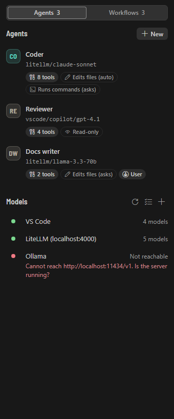

The sidebar has two tabs.

**Agents** lists every agent with its model, the number of tools and badges that say what it can do:
**Read-only**, **Edits files** and **Runs commands**, each with its permission level (**asks** or **auto**;
see [What an agent can do](#what-an-agent-can-do)). **User** marks user agents. Select a row to open the
agent editor. **New** asks for a name, a starter (**Blank**, **Coder** or **Reviewer**) and where to save it
(**Workspace** or **User**). The Blank starter is read-only; for an agent that should change code, pick
**Coder**. The trash button deletes an agent after you confirm it in the row; the file goes to the trash.

Below the agents, **Models** lists the model providers with their status and model count. Select an
endpoint to edit it, use the key button to set its API key, the beaker button to test its models
([Testing a model](#testing-a-model)) and the trash button to remove it (confirmed in the row). The
checklist button runs **Check setup** ([Checking the setup](#checking-the-setup)); the refresh button lists
all models again; **+** adds an endpoint.

**Workflows** lists every workflow in the workspace with its last run. The button at the end of a row runs
the workflow; while it runs, the button stops it. **New** asks for a name and a template: **Blank**, **Review loop** (implement, test and
review until approved) or **Test and fix** (run tests and fix failures until they pass). **Recent runs**
shows running and finished runs; select one to show it on the canvas. A run whose changes still wait for
your decision shows **2 to review** ([Reviewing changes](#reviewing-changes)).

In Restricted Mode the sidebar says that running is disabled until you trust the workspace.

## 4. The river editor

Opening a `*.workflow.yaml` (or `.workflow.yml`) file shows the river editor:

- **Top bar**: the workflow name (select it to rename), the file name, the validation state, **Runs**
  (live run and history), **Open YAML** and **Run** or, while running, the elapsed time and **Stop**.
- **Palette** (left): the block types and your agents. The arrow button collapses it to a narrow rail.
- **Canvas** (middle): the river. Blocks sit on it from top to bottom. An If / else block splits it into a
  **Then** and an **Else** lane, a loop draws a return channel on its left.
- **Inspector** (right): the settings of the selected block. With nothing selected it shows the workflow:
  name, description, where it runs ([Running in a separate worktree](#running-in-a-separate-worktree)),
  inputs, environment variables and runs. During and after a run, it shows the run summary with time and
  tokens per block ([Time and tokens](#time-and-tokens)), and a selected block has a **Run output** tab next
  to **Settings**.
- **Review card** (above the canvas): after a run that changed files, the changed files with **Keep** and
  **Revert** ([Reviewing changes](#reviewing-changes)).

### Adding blocks

- **Click** a block type or an agent in the palette to add it after the selected block, or at the end of
  the workflow when nothing is selected.
- **Drag** a palette item onto the river. While you drag, every insertion point opens into a drop slot.
  Empty lists, such as a new loop or lane, show one slot.
- **Hover** between two blocks and select the **+** that appears to pick a block type for that spot.

Dropping an agent from the palette creates an Agent block that uses it. **Break** can only be added inside a
loop. New blocks get ids like `console_1` or `agent_2`; rename them in the inspector.

### Editing

Select a block and edit it in the inspector. Text fields with templates have an **Insert variable** button
(`{x}`) that lists the inputs, the outputs of other blocks, the loop variables and more, and inserts
`${{ … }}` at the cursor. Problems are shown next to the field they belong to.

### Moving, duplicating and deleting

- **Drag** a block (or the header of a loop or If / else block) to another insertion point. A container
  cannot be dropped into itself.
- **Move to…** lists every place the block can go: in the block menu (right-click a block) and as the move
  button in the inspector header. It is the keyboard-friendly way to move blocks between lists.
- **Alt+↑ / Alt+↓** moves the selected block up or down within its list.
- The block menu also has **Duplicate**, **Show in YAML** and **Delete**.

### Keyboard shortcuts

These work while the canvas or a block has focus.

| Keys                      | Action                                                 |
| ------------------------- | ------------------------------------------------------ |
| ↓ / → and ↑ / ←           | Select the next or previous block (in document order). |
| Alt+↑ / Alt+↓             | Move the selected block within its list.               |
| Delete / Backspace        | Delete the selected block.                             |
| Ctrl+D (Cmd+D on macOS)   | Duplicate the selected block.                          |
| Shift+F10 or the menu key | Open the block menu (Move to…, Duplicate, …).          |
| Enter                     | Move focus to the inspector.                           |
| Escape                    | Clear the selection.                                   |
| Ctrl / Cmd + mouse wheel  | Zoom between 50 % and 150 %.                           |

The zoom control at the bottom right has zoom out, the zoom level, zoom in and **Fit**, which fits the whole
river into view.

### YAML side by side and two-way sync

**Open YAML** opens the YAML text editor beside the canvas; **Show in YAML** in the block menu also
selects the block's lines. You can edit either side:

- **Canvas → YAML**: every visual edit is applied to the YAML document as a small text change. Comments,
  key order and formatting of the rest of the file stay as they are. The file becomes dirty like any edited
  file: save it with Ctrl+S and undo it with Ctrl+Z.
- **YAML → canvas**: the canvas follows your typing (after a short pause). Problems appear on the canvas,
  in the inspector and in the **Problems** view.
- **YAML that cannot be read**: the canvas keeps showing the last readable version, dimmed, with a banner
  that names the problem and its line, and a **Show in YAML** button. Fixing the YAML brings the canvas back.
- **Blocks without ids**: blocks need an id to be selected, edited or referenced. A banner offers **Add
  ids**, which gives each of them a unique id.

`*.workflow.yaml` files open in the river editor by default. To open the file as text, use **Open YAML**,
the **Open YAML** command or **Reopen Editor With… → Text Editor**. From the text editor, the **Open in
canvas** CodeLens at the top of the file and the editor title button switch back.

With the [YAML extension by Red Hat](https://marketplace.visualstudio.com/items?itemName=redhat.vscode-yaml)
installed, workflow and agent files also get completion, hovers and validation from Isar Flow's JSON Schemas.

## 5. Workflow files

```yaml
version: 1 # always 1
name: Review until approved
description: Optional text shown in the sidebar.
inputs: # asked for when the run starts
  task: { type: string, description: What should be implemented?, required: true, multiline: true }
  rounds: { type: number, default: 5 }
  dryRun: { type: boolean, default: false }
env: # environment variables for every console command, readable as env.NAME
  CI: '1'
  API_TOKEN: ${{ secrets.API_TOKEN }}
isolation: workspace # workspace (default) or worktree: run on a separate git worktree
setup: [npm ci] # only with isolation: worktree; runs in the worktree before the first block
steps: [] # the blocks
```

**isolation** and **setup**: see [Running in a separate worktree](#running-in-a-separate-worktree).

**Inputs**: names start with a letter or `_` and contain letters, digits, `_` and `-`. Each input can have:

| Field         | Meaning                                                                                                |
| ------------- | ------------------------------------------------------------------------------------------------------ |
| `type`        | `string`, `number` or `boolean`. Values are converted to this type; a number input rejects other text. |
| `description` | Shown when Isar Flow asks for the value.                                                               |
| `default`     | Used when the value is left empty.                                                                     |
| `required`    | The run does not start without a value.                                                                |
| `multiline`   | Shows a larger text field in the run dialog of the canvas.                                             |

**Workflow env** is rendered once when the run starts, before any block runs. It can use `inputs`,
`secrets`, `env`, `workflow`, `workspace` and `run`, but not the outputs of blocks or `loop`.

### Fields every block has

| Field             | Meaning                                                                                                                                                                                                                             |
| ----------------- | ----------------------------------------------------------------------------------------------------------------------------------------------------------------------------------------------------------------------------------- |
| `id`              | Required and unique in the workflow. Starts with a letter or `_`, then letters, digits, `_` and `-`.                                                                                                                                |
| `type`            | `agent`, `console`, `loop`, `if`, `break`, `stop` or `approval`.                                                                                                                                                                    |
| `name`            | Optional label shown on the canvas instead of the id.                                                                                                                                                                               |
| `timeout`         | Seconds. The block fails with "Timed out after Ns" when it takes longer; a console command is stopped with all the processes it started.                                                                                            |
| `continueOnError` | When `true`, a failed block does not fail the run. Its status is still `failure` and its outputs can be checked.                                                                                                                    |
| `retry`           | `{ max: 1–10, delay: seconds }`. Runs a failed block again, up to `max` more times. Not retried: template errors, a missing agent or model, a rejected approval, a Stop block and an agent block after the token budget is used up. |

### Outputs every block has

| Output       | Meaning                                                                                     |
| ------------ | ------------------------------------------------------------------------------------------- |
| `status`     | `success`, `failure`, `skipped` (in the branch of an If that was not taken) or `cancelled`. |
| `durationMs` | How long the block took.                                                                    |
| `error`      | Why the block failed or was cancelled.                                                      |

A block that has not run yet has no outputs: `steps.<id>.text` reads as empty.

## 6. Blocks

### Agent

Gives an agent a task and makes its answer available to later blocks.

```yaml
- id: review
  type: agent
  agent: reviewer # an agent id, or inline settings (see below)
  model: litellm/claude-sonnet # optional: overrides the agent's model for this block
  prompt: |
    Review the changes. The tests exited with code ${{ steps.tests.exitCode }}.
    ${{ tail(steps.tests.output, 80) }}
  output:
    format: json # text (default) or json
    schema: { approved: boolean, issues: 'string[]' }
  session: fresh # fresh (default) or continue
  context:
    files: ['src/**/*.ts', README.md] # attached to the prompt
```

| Field           | Meaning                                                                                                                                                               |
| --------------- | --------------------------------------------------------------------------------------------------------------------------------------------------------------------- |
| `agent`         | Id of an agent file, or inline agent settings: `model`, `fallbackModels`, `systemPrompt`, `temperature`, `maxTokens`, `maxTurns`, `tools`, `toolMode`, `permissions`. |
| `model`         | Overrides the agent's model. Without an `agent`, the block uses this model with no system prompt and no tools.                                                        |
| `prompt`        | The task. Supports templates.                                                                                                                                         |
| `output`        | `format: json` asks for a JSON answer and parses it ([JSON answers](#json-answers)).                                                                                  |
| `session`       | `continue` keeps the conversation of this block between loop iterations; `fresh` starts a new one every time.                                                         |
| `context.files` | Workspace-relative globs. Matching files are appended to the prompt: at most 20 files, 100 KB per file and 400 KB in total.                                           |

Outputs:

| Output                                    | Meaning                                                                                                          |
| ----------------------------------------- | ---------------------------------------------------------------------------------------------------------------- |
| `text`                                    | The final answer.                                                                                                |
| `json`                                    | The parsed answer, only with `output.format: json`.                                                              |
| `model`                                   | The model that answered (a fallback model when the main one failed).                                             |
| `usage.inputTokens`, `usage.outputTokens` | Tokens used, across all model calls of the block (every attempt of a retried block, and conversation summaries). |
| `turns`                                   | Model calls the agent needed, tool rounds included.                                                              |
| `toolCalls`                               | Tool calls the agent made (every attempt of a retried block).                                                    |

### Console

Runs a command line and captures its output.

```yaml
- id: tests
  type: console
  run: npm test
  shell: auto # auto, pwsh, powershell, cmd, bash or sh
  cwd: packages/app # relative to the workspace folder (default: the folder itself)
  env:
    NODE_ENV: test
  continueOnError: true # let a condition look at the exit code instead of failing the run
  timeout: 600
```

| Field   | Meaning                                                                                                                                                                                                                                            |
| ------- | -------------------------------------------------------------------------------------------------------------------------------------------------------------------------------------------------------------------------------------------------- |
| `run`   | The command line, also several lines. Supports templates (but see [Security](#16-security)).                                                                                                                                                       |
| `shell` | `auto` uses PowerShell 7 (`pwsh`) or else Windows PowerShell on Windows, and your login shell (`$SHELL`), else `/bin/bash`, else `/bin/sh` elsewhere. `bash` on Windows is Git Bash. Without `shell`, the `isarFlow.defaultShell` setting applies. |
| `cwd`   | Working folder. Relative paths start at the workspace folder of the workflow.                                                                                                                                                                      |
| `env`   | Extra environment variables on top of VS Code's environment and the workflow `env`.                                                                                                                                                                |

Output is read as UTF-8 (PowerShell and cmd are switched to UTF-8 for the command). A console block
**fails when the exit code is not 0** unless `continueOnError: true` is set.

Outputs: `exitCode`, `stdout`, `stderr`, `output` (stdout and stderr in the order they arrived) and
`timedOut`.

### Loop

Repeats its blocks. See [Loops](#9-loops).

```yaml
- id: review_loop
  type: loop
  until: '${{ steps.tests.exitCode == 0 && steps.review.json.approved }}'
  maxIterations: 5 # required, 1–100
  onMaxIterations: fail # fail (default) or continue
  steps: []
```

Outputs: `iterations` (how many iterations ran) and `exitReason` (`condition`, `maxIterations` or `break`).

### If / else

Runs the `then` blocks when the condition is true, otherwise the `else` blocks. See [Conditions](#8-conditions).

```yaml
- id: needs_fix
  type: if
  condition: { value: '${{ steps.tests.exitCode }}', op: neq, to: 0 }
  then:
    - id: fix
      type: agent
      agent: coder
      prompt: 'The tests fail. Fix them: ${{ tail(steps.tests.output, 80) }}'
  else: [] # optional
```

Outputs: `branch` (`then` or `else`) and `result` (`true` or `false`). Blocks of the branch that was not
taken are reported as `skipped`.

### Break

Leaves the innermost loop at once; the loop ends with `exitReason: break` and the run goes on after it. Only
valid inside a loop (also inside an If / else that is inside a loop).

```yaml
- id: done
  type: break
```

### Stop

Ends the whole run.

```yaml
- id: nothing_to_do
  type: stop
  outcome: success # failure (default) or success
  message: No changes since the last release. # supports templates
```

With `outcome: failure` the run fails with the message (or "Stopped by block '…'"); with `success` it ends
as succeeded.

### Approval

Pauses the run until you approve or reject.

```yaml
- id: approve
  type: approval
  message: |
    Publish these notes?
    ${{ steps.draft.text }}
  onReject: stop # stop (default) or continue
```

The request appears as a banner on the canvas with an optional comment, **Approve** and **Reject**. When the
workflow's canvas is not visible, VS Code shows a dialog with **Approve** and **Reject** instead. With `onReject: stop` a
rejection ends the run as failed ("Rejected at '…'"); with `continue` the run goes on and later blocks can
check `steps.<id>.approved`. Stopping the run or reaching the block's `timeout` counts as a rejection.

Outputs: `approved` (`true` or `false`) and `comment` (empty without a comment).

## 7. Expressions and templates

Any text field that supports templates can contain `${{ expression }}`:

```yaml
prompt: 'Fix the ${{ length(steps.review.json.issues) }} issues: ${{ toJSON(steps.review.json.issues) }}'
```

- When the whole value is a single `${{ … }}`, the result keeps its type (a number, a boolean, a list).
- Otherwise each result is inserted as text: lists and objects as indented JSON, `null` and missing values
  as empty text.
- Expressions never run code. A name that does not exist reads as missing (empty), also deep paths such as
  `steps.later.json.issues`.

In YAML, quote a value that starts with `${{` inside `{ … }` or `[ … ]`, a value that starts with `!`, and
any value that contains `: ` or ` #`. Values in block style (`prompt: |`) never need quotes.

### What expressions can read

| Name                             | Value                                                                                           |
| -------------------------------- | ----------------------------------------------------------------------------------------------- |
| `inputs.<name>`                  | Workflow inputs, with defaults applied and converted to their `type`.                           |
| `steps.<id>.<output>`            | Outputs of a block that already ran. Inside a loop, always the latest run of the block.         |
| `env.<NAME>`                     | VS Code's environment variables plus the workflow `env`. Names are case-sensitive here.         |
| `loop.iteration`, `loop.index`   | Iteration of the innermost loop: `iteration` counts from 1, `index` from 0. Only inside a loop. |
| `workflow.name`, `workflow.file` | Name of the workflow and the full path of its file.                                             |
| `workspace.root`                 | The workspace folder of the workflow.                                                           |
| `run.id`                         | Id of the current run.                                                                          |
| `secrets.<NAME>`                 | Stored workflow secrets ([Secrets](#13-secrets)). A secret that is not stored reads as empty.   |

Ids and names may contain `-`: `steps.unit-tests.exitCode` reads the block `unit-tests`. Write `a - b` with
spaces to subtract. Use brackets for any other key: `steps.review.json['issue count']`, `lines(x)[0]`.

### Syntax

| Kind      | Examples                                                                                                                                                   |
| --------- | ---------------------------------------------------------------------------------------------------------------------------------------------------------- |
| Literals  | `42`, `1.5`, `'text'`, `"text"`, `true`, `false`, `null`, lists `['a', 'b']`                                                                               |
| Escapes   | `\n`, `\t`, `\r`, `\\`, `\'`, `\"`. Other backslashes are kept, so regular expressions such as `'\d+'` work.                                               |
| Access    | `a.b`, `a['b']`, `list[0]`, `text.length`, `list.length`                                                                                                   |
| Operators | from highest to lowest precedence: `!` and unary `-`; `*` `/` `%`; `+` `-`; `<` `<=` `>` `>=`; `==` `!=`; `&&`; `\|\|`; `cond ? a : b`. Parentheses group. |

Rules worth knowing:

- `==` and `!=` (also written `===` and `!==`) compare numbers as numbers, also when one side is text:
  `steps.tests.exitCode == '0'` is true. Text is compared case-sensitively. `true` equals the text `'true'`.
  `null` and missing values only equal each other. Lists and objects are equal when their JSON is equal.
- `<`, `<=`, `>`, `>=` compare numerically when both sides look like numbers, otherwise as text.
- `+` joins text when either side is text and adds otherwise.
- `!`, `&&`, `||` and `? :` treat `false`, `0`, empty text, `null` and missing values as false.
  `a || 'fallback'` gives `a`, or `'fallback'` when `a` is one of these.

### Functions

Functions accept any value; text functions convert their input to text first.

| Function                                  | Result                                                           |
| ----------------------------------------- | ---------------------------------------------------------------- |
| `contains(haystack, needle, ignoreCase?)` | True if a text contains a substring, or a list contains a value. |
| `startsWith(text, prefix)`                | True if the text starts with the prefix.                         |
| `endsWith(text, suffix)`                  | True if the text ends with the suffix.                           |
| `matches(text, pattern, flags?)`          | True if the regular expression matches the text.                 |
| `length(value)`                           | Length of a text or list, number of keys of an object.           |
| `lower(text)`                             | Lowercase text.                                                  |
| `upper(text)`                             | Uppercase text.                                                  |
| `trim(text)`                              | Text without surrounding whitespace.                             |
| `head(text, n)`                           | First n lines of a text.                                         |
| `tail(text, n)`                           | Last n lines of a text.                                          |
| `lines(text)`                             | List of lines in a text.                                         |
| `json(text)`                              | Parses JSON text into a value.                                   |
| `toJSON(value)`                           | Formats a value as JSON text.                                    |
| `join(list, separator?)`                  | Joins list items into one text.                                  |
| `default(value, fallback)`                | The value, or the fallback when it is empty.                     |
| `number(value)`                           | Converts to a number.                                            |
| `string(value)`                           | Converts to text.                                                |

Details: regular expressions use JavaScript syntax, `flags` such as `'i'` or `'m'`. `head`, `tail` and
`lines` split at `\n` and `\r\n`. `join` uses `, ` without a separator. `default` treats `null`, missing
values and empty text as empty. `number('')` is `0`. An unknown function or an invalid literal regular
expression is reported before the run.

Examples:

```text
${{ tail(steps.tests.output, 50) }}                     last 50 lines of the test output
${{ matches(steps.build.stdout, 'warning \d+', 'i') }}  true when the build printed a warning
${{ steps.review.json.approved ? 'approved' : 'changes requested' }}
${{ join(steps.review.json.issues, '\n- ') }}
${{ default(inputs.branch, 'main') }}
${{ json(steps.manifest.stdout).version }}
```

## 8. Conditions

`if` blocks and the `until` / `while` of loops take a condition in one of two forms.

**Expression form**: a template or a bare expression.

```yaml
condition: '${{ steps.tests.exitCode != 0 }}'
condition: steps.tests.exitCode != 0 # the same, without ${{ }}
```

**Structured form**: rules, which is what the condition builder writes.

```yaml
condition:
  any: # all | any | not
    - { value: '${{ steps.tests.exitCode }}', op: neq, to: 0 }
    - { value: '${{ steps.review.text }}', op: contains, to: CHANGES, ignoreCase: true }
```

- `all: [...]` is true when every rule is true, `any: [...]` when at least one is, `not: rule` inverts a rule.
  Groups can be nested.
- `value` and `to` may contain templates. `ignoreCase: true` makes text comparisons ignore case.
- `contains` on a list checks whether the list has an item equal to `to`.

| `op`          | Meaning              | Needs `to` |
| ------------- | -------------------- | ---------- |
| `eq`          | equals               | yes        |
| `neq`         | does not equal       | yes        |
| `gt`          | is greater than      | yes        |
| `gte`         | is at least          | yes        |
| `lt`          | is less than         | yes        |
| `lte`         | is at most           | yes        |
| `contains`    | contains             | yes        |
| `notContains` | does not contain     | yes        |
| `matches`     | matches regex        | yes        |
| `notMatches`  | does not match regex | yes        |
| `startsWith`  | starts with          | yes        |
| `endsWith`    | ends with            | yes        |
| `isEmpty`     | is empty             | no         |
| `isNotEmpty`  | is not empty         | no         |
| `isTrue`      | is true              | no         |
| `isFalse`     | is false             | no         |

`eq` and `neq` compare like `==`; `gt` … `lte` like `<` … `>=`. `isEmpty` is true for missing values,
`null`, text that is empty or only spaces, empty lists and empty objects.

**From value to true or false**: the result of an expression-form condition and the value checked by
`isTrue` / `isFalse` count as false when they are `false`, `0`, empty text, `null`, missing, or the text
`false`, `0`, `no`, `off` or `null` (in any case). Everything else is true.

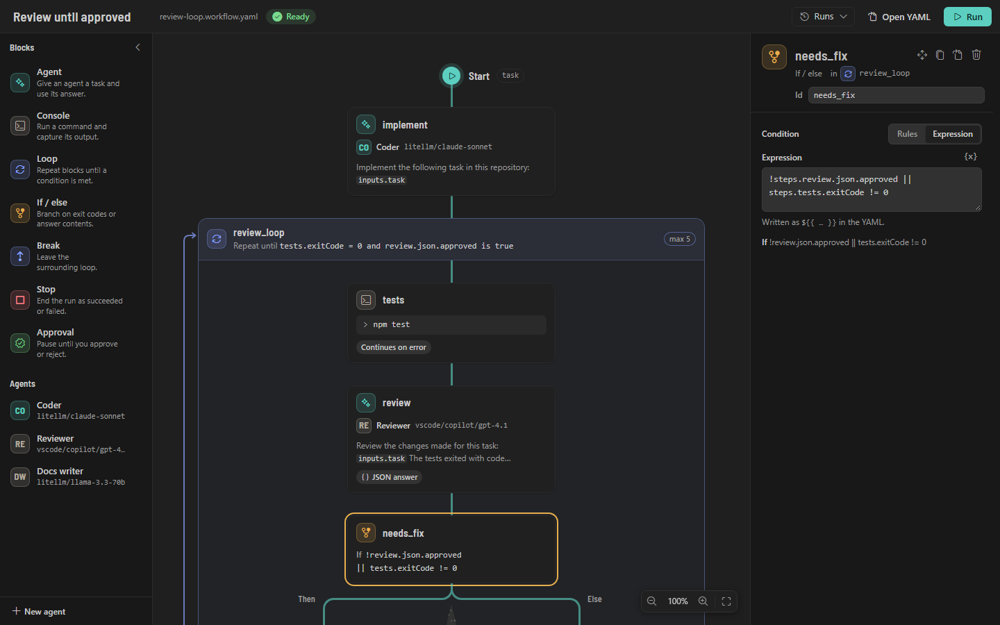

In the inspector, the condition builder switches between **Rules** and **Expression**. Rules edit a flat
list combined with **all** or **any**; a condition with nested groups is edited in YAML.

## 9. Loops

A loop repeats its blocks in one of three ways:

| Mode            | YAML                        | Behavior                                                                                     |
| --------------- | --------------------------- | -------------------------------------------------------------------------------------------- |
| **Until**       | `until: <condition>`        | Runs the blocks, then checks the condition; ends when it is true. Always runs at least once. |
| **While**       | `while: <condition>`        | Checks the condition before each iteration, the first one included; ends when it is false.   |
| **Fixed times** | neither `until` nor `while` | Runs the blocks exactly `maxIterations` times (unless a Break leaves earlier) and succeeds.  |

`maxIterations` (1–100) is required, so every run ends. The canvas writes 5. When a loop with a condition
reaches the limit and the condition still asks for another round, `onMaxIterations` decides:

- `fail` (default): the loop fails and so does the run ("Loop '…' reached its limit of N iterations
  without meeting its condition").
- `continue`: the loop ends with `exitReason: maxIterations` and the run goes on.

Inside the loop:

- `loop.iteration` (from 1) and `loop.index` (from 0) belong to the innermost loop.
- `steps.<id>` always holds the latest run of a block: a block sees the current iteration's outputs of the
  blocks before it and the previous iteration's outputs of the blocks after it. `until` is checked after
  the whole body ran, so it sees the current iteration.
- A block in an If / else branch that was not taken in this iteration holds `status: skipped` and no other
  outputs.
- **Break** leaves the innermost loop immediately (`exitReason: break`).
- An agent block with `session: continue` remembers its conversation from earlier iterations.

The loop block's outputs are `iterations` and `exitReason` (`condition`, `maxIterations` or `break`).

## 10. Agents

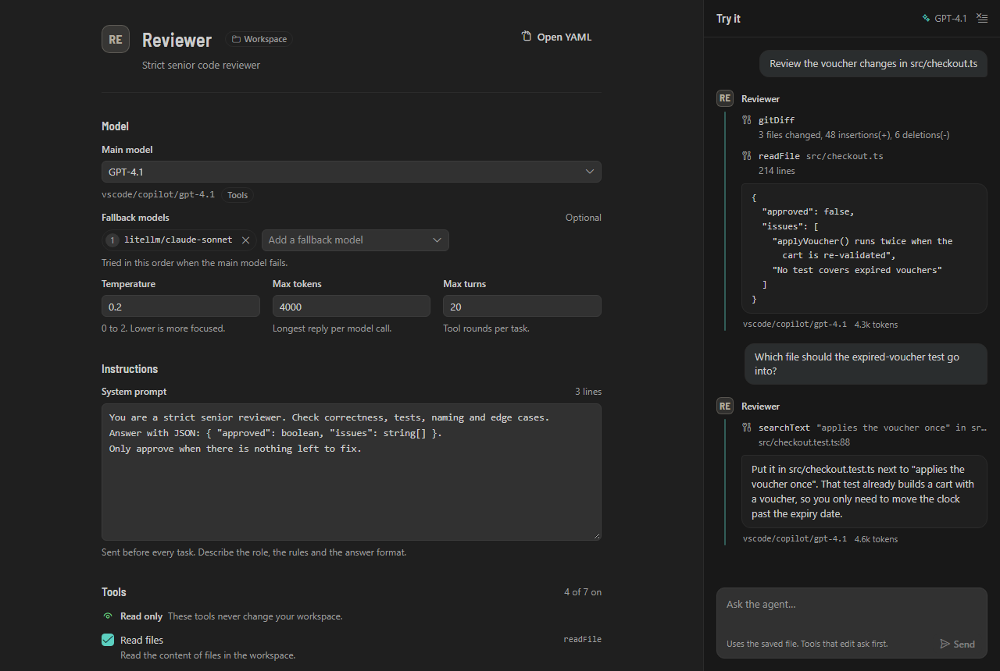

### Agent files

```yaml
# .isarflow/agents/reviewer.agent.yaml — workflows use it as "agent: reviewer"
name: Reviewer
description: Strict senior code reviewer
model: litellm/claude-sonnet
fallbackModels: [vscode/copilot/gpt-4.1]
systemPrompt: |
  You are a strict senior reviewer. Answer with JSON only.
temperature: 0.2
maxTokens: 4000
maxTurns: 20
tools: [readFile, listFiles, searchText, gitDiff]
toolMode: auto # auto (default) | native | text
permissions: { edits: none, commands: none } # none | ask | auto
```

| Field            | Meaning                                                                                    |
| ---------------- | ------------------------------------------------------------------------------------------ |
| `name`           | Required. Display name.                                                                    |
| `description`    | Optional. Shown in the sidebar.                                                            |
| `model`          | Required. `<provider>/<model>`, for example `vscode/copilot/gpt-4.1` or `litellm/gpt-4.1`. |
| `fallbackModels` | Tried in order when the main model is unavailable ([Fallback models](#fallback-models)).   |
| `systemPrompt`   | Sent before every task: the role, the rules and the answer format.                         |
| `temperature`    | 0 to 2. Lower is more focused.                                                             |
| `maxTokens`      | Longest reply per model call.                                                              |
| `maxTurns`       | 1–200 model calls per task (default 20). A tool round counts as one call.                  |
| `tools`          | Built-in tools the agent may use ([Tools](#tools)). Without tools, the agent only answers. |
| `toolMode`       | How the model calls tools: `auto`, `native` or `text` ([Tool calls](#tool-calls)).         |
| `permissions`    | `edits` and `commands`: `none`, `ask` or `auto` ([Permissions](#permissions)).             |

The **agent editor** opens for `*.agent.yaml` files: name and description with the agent's badges
([What an agent can do](#what-an-agent-can-do)), **Model** (main model with **Test model**, fallback models,
**Tool calls**, temperature, max tokens, max turns), **Instructions** (system prompt), **Tools**,
**Permissions** and **Used by** (the workflows that use the agent; select one to open it). Every change is
written to the YAML, comments included; **Open YAML** shows the text.

**Try it** (right) chats with the agent as it is in the editor, unsaved changes included. Tools work as in
a run, except that `auto` permissions ask first. Workflow runs use the saved agent files.

### Tools

Tools only work inside the workspace folder of the workflow ([Security](#16-security)).

| Tool         | Label            | Arguments                        | What it does                                                                                                   | Gate       |
| ------------ | ---------------- | -------------------------------- | -------------------------------------------------------------------------------------------------------------- | ---------- |
| `readFile`   | Read files       | `path`, `startLine?`, `endLine?` | Reads a file, or some of its lines. Output is cut at 200 KB with a note on how to continue.                    | —          |
| `listFiles`  | List files       | `glob?`                          | Lists files matching a glob, at most 500. `node_modules` and `.git` are skipped.                               | —          |
| `searchText` | Search text      | `query`, `glob?`, `isRegex?`     | Finds lines as `path:line: text`, at most 200 matches.                                                         | —          |
| `gitDiff`    | View git changes | `staged?`                        | `git diff` (or `git diff --staged`) of the repository, cut at 200 KB.                                          | —          |
| `editFile`   | Edit files       | `path`, `oldText`, `newText`     | Replaces text that occurs exactly once in an existing file (see below).                                        | `edits`    |
| `applyPatch` | Apply patches    | `patch`                          | Applies a unified diff to one or more files: changes, new files and deleted files, all or nothing (see below). | `edits`    |
| `writeFile`  | Write files      | `path`, `content`                | Creates a file or replaces all of its content.                                                                 | `edits`    |
| `runCommand` | Run commands     | `command`, `cwd?`                | Runs a command in the `isarFlow.defaultShell` and returns its exit code and output. Stopped after 120 seconds. | `commands` |

Edits go through VS Code, so they show up in open editors, can be undone, and are saved right away so
later console blocks see them. Files inside `.git` cannot be changed. After the run, every changed file is
listed for review ([Reviewing changes](#reviewing-changes)).

**editFile** matches `oldText` exactly. If it is not found, line-ending differences and then whitespace
differences per line are ignored, and the indentation comes from the file. The match must be unique: when
`oldText` occurs in several places, the agent is told to include more surrounding lines. The result says
when the match needed one of the tolerant steps.

**applyPatch** takes the format of `git diff` and `diff -u`: `--- a/<path>` and `+++ b/<path>` per file,
`--- /dev/null` to create a file and `+++ /dev/null` to delete one, and `@@` hunks with a few lines of
context. Prose and code fences around the diff are ignored. Each hunk is searched near the line it names
(and then in the whole file), ignoring trailing whitespace and line-ending differences, and then whitespace
within lines; added lines take the indentation of the file. Files keep their line endings and their final
newline. Either every hunk applies or no file changes: a failing hunk is reported with the line where the
context differs, so the agent can read the file again and make a new patch. Renames, copies and binary
patches are refused. The permission question shows the patch (`Patch src/app.ts` or `Patch 3 files`).

### Permissions

`permissions.edits` gates `editFile`, `applyPatch` and `writeFile`, `permissions.commands` gates
`runCommand`. Reading tools never ask.

| Level  | In the agent editor | Effect                                                                        |
| ------ | ------------------- | ----------------------------------------------------------------------------- |
| `none` | Never               | Every call is refused; the agent is told so and can continue without it.      |
| `ask`  | Ask                 | VS Code asks before each call: **Allow**, **Allow for this run** or **Deny**. |
| `auto` | Always              | Runs without asking.                                                          |

A level that is not set means `ask`. **Allow for this run** allows that tool for the rest of the run.
A denied call is reported to the model as a tool error.

### What an agent can do

Agent rows in the sidebar, the agent editor's header and Agent blocks on the canvas show badges:

| Badge                           | Meaning                                                                                                  |
| ------------------------------- | -------------------------------------------------------------------------------------------------------- |
| **Read-only**                   | The agent can read files but has no tool that changes them or runs commands.                             |
| **Edits files (asks / auto)**   | It has `editFile`, `applyPatch` or `writeFile`, and `permissions.edits` is `ask` (or not set) or `auto`. |
| **Runs commands (asks / auto)** | It has `runCommand`, and `permissions.commands` is `ask` (or not set) or `auto`.                         |

A tool whose permission is `none` does not count, because every call of it is refused.

### Tool calls

Models call tools in one of two ways. Most hosted models have native tool calling; many local models (for
example some Ollama or vLLM models) don't, but can follow tool descriptions in the prompt. **Tool calls** in
the agent editor (`toolMode` in YAML) chooses how:

- **Automatic** (`auto`, the default) uses the model's native tool calling and also runs tool calls the
  model writes as text. Models without native tool calling, and models whose [test](#testing-a-model) said
  **Needs text tool mode**, get the tools described in the prompt instead.
- **Native** (`native`) sends the tools only natively; text that looks like a tool call stays text.
- **Text in the prompt** (`text`) always describes the tools in the system prompt. The model calls them as
  `<tool_call>{"name": "readFile", "arguments": {"path": "src/app.ts"}}</tool_call>`, one or more per
  answer, and answers without a call when it is done.

Tool calls written as text are recognized in `<tool_call>` tags, in fenced `json` blocks and as plain JSON
with `name` and `arguments` (or `tool` and `args`). Only the names of the agent's tools count. When a call
names a tool but its arguments can't be read, the model is asked once to correct it; a second unreadable
answer in a row fails the block. The run log notes when a tool call written as text is run.

### Long conversations

Agents that read many files can outgrow the model's context. Before each model call, Isar Flow estimates the
size of the conversation (about 4 characters per token). When it grows above 70 % of the model's context
(the size the model reports, else `isarFlow.agentContextTokens`, default 24000), older turns are replaced
by a summary written by the same model. The system prompt, the task and the latest tool results stay in
full. The run log shows a line for each summary, such as "Compacted the conversation: 24 older messages
(about 19,800 tokens) replaced by a summary (about 450 tokens)." The summary's tokens count toward the
block. When even the parts that are always kept are too large, the log says so once: attach fewer or
smaller context files, or use a model with a larger context.

### Fallback models

When the main model cannot answer (it is unknown, unreachable, rate-limited or the server fails), the
fallback models are tried in order. A fallback model continues the conversation where the failed one
stopped, so finished tool calls are not repeated. Authentication errors, invalid requests and cancellation
do not fall back. The block's `model` output names the model that answered.

### JSON answers

With `output: { format: json }` the agent is told to answer with JSON only, and the answer is parsed: plain
JSON, a fenced `json` code block, or the first JSON object or list in the text. Without a `schema` any JSON
is accepted. With a `schema`, the answer must match it. When it does not, the agent gets one chance to
correct it; after that the block fails with the problems found.

A schema is either a compact shape:

```yaml
schema:
  approved: boolean
  issues: 'string[]' # [] makes a list
  severity?: string # ? makes a key optional (it may also be null)
  score: 'number?' # same as score?
  location: { file: string, line: integer } # nested object
  tags: [string] # one-element list: same as 'string[]'
  extra: any
```

Types: `string`, `number`, `integer`, `boolean`, `object`, `array` and `any`. Or a full JSON Schema
(recognized by `properties`, or by a JSON Schema `type` with only JSON Schema keywords):

```yaml
schema:
  type: object
  properties:
    approved: { type: boolean }
    issues: { type: array, items: { type: string } }
  required: [approved, issues]
```

Answers are checked for `type`, `required`, `properties`, `items` and `enum`. The expected shape is always
part of the instructions; OpenAI-compatible endpoints also receive it as `response_format` (left out again
for a model whose server rejects it).

Later blocks read the answer as `steps.<id>.json.<field>`. Quote compact types that contain `[]` or `?`
inside `{ … }`, as in `{ approved: boolean, issues: 'string[]' }`.

### Inline agents

A block can define its agent inline instead of referring to a file:

```yaml
- id: summarize
  type: agent
  agent:
    model: vscode/copilot/gpt-4.1
    systemPrompt: Summarize test output in three bullet points.
    temperature: 0
  prompt: '${{ tail(steps.tests.output, 200) }}'
```

## 11. Models

Agents name models as `<provider>/<model>`. The provider id ends at the first `/`, so model ids may
contain `/` themselves: `openrouter/anthropic/claude-sonnet-4`.

### VS Code models

Models that other extensions offer to VS Code, such as GitHub Copilot, appear as provider **VS Code** with
references like `vscode/copilot/gpt-4.1`. They need no setup. The first time an agent uses one, VS Code
asks whether Isar Flow may use it; if you declined, allow it again under **Accounts → Manage Language Model
Access**. Turn VS Code models off with `isarFlow.vscodeModels`. Their token usage is counted with the
model's tokenizer.

### OpenAI-compatible endpoints

Run **Isar Flow: Add model endpoint** (or **+** under **Models** in the sidebar) and pick a preset:

| Preset     | Suggested id | Base URL                       | API key               |
| ---------- | ------------ | ------------------------------ | --------------------- |
| LiteLLM    | `litellm`    | `http://localhost:4000`        | asked, may stay empty |
| Ollama     | `ollama`     | `http://localhost:11434/v1`    | not needed            |
| OpenRouter | `openrouter` | `https://openrouter.ai/api/v1` | asked                 |
| OpenAI     | `openai`     | `https://api.openai.com/v1`    | asked                 |
| Custom…    | —            | your URL (vLLM, LM Studio …)   | asked, may stay empty |

Isar Flow asks for the id (the first part of model references), the base URL and the API key, saves the
endpoint in your user settings (or in the workspace settings, when the trusted workspace already defines
`isarFlow.providers`) and lists its models with `GET <base URL>/models`. Models appear in every
model picker as `<id>/<model>`.

**LiteLLM**

1. Start the proxy, for example `litellm --config config.yaml`. It listens on `http://localhost:4000`.
2. Run **Isar Flow: Add model endpoint**, choose **LiteLLM**, keep the id `litellm` and the URL, and enter
   a LiteLLM key (a virtual key or the master key). Leave it empty if your proxy has no key.
3. The `model_name`s of your config appear as `litellm/<model_name>`.

**Ollama**: choose **Ollama**; no key is needed. Pulled models appear as `ollama/<model>`, for example
`ollama/llama3.1:8b`. For agents with tools, pick a model that supports tool calling, or
[test the model](#testing-a-model): models without native tool calling work in text tool mode.

**OpenRouter**: choose **OpenRouter** and enter your OpenRouter key. Models appear as
`openrouter/<vendor>/<model>`.

The base URL may end with or without `/v1`: when the plain URL answers 404, Isar Flow tries `<url>/v1` and
keeps using it. Requests that fail with a rate limit, a server error or a network error are tried three
times in total, waiting longer each time (and as long as the server asks with `Retry-After`, up to 30 s);
after that an agent's fallback models are tried.

**Settings**: endpoints are stored in `isarFlow.providers`. API keys are never written there; they are kept
in VS Code's secret storage.

```jsonc
// settings.json
"isarFlow.providers": [
  { "id": "litellm", "label": "LiteLLM", "baseUrl": "http://localhost:4000" },
  { "id": "ollama", "label": "Ollama", "baseUrl": "http://localhost:11434/v1" },
  // A server that cannot list its models: name them yourself.
  { "id": "vllm", "baseUrl": "http://gpu-box:8000/v1", "discoverModels": false, "models": ["qwen2.5-coder"] },
  // Extra HTTP headers, for example for a gateway.
  { "id": "gateway", "baseUrl": "https://llm.example.com/v1", "headers": { "X-Team": "platform" } }
]
```

| Field            | Meaning                                                                                      |
| ---------------- | -------------------------------------------------------------------------------------------- |
| `id`             | Required. Lowercase letters, digits, `-` and `_`. `vscode` is reserved.                      |
| `label`          | Name in the model pickers (default: the id).                                                 |
| `baseUrl`        | Required. `http://` or `https://` address of the API.                                        |
| `discoverModels` | `false` skips `GET /models`.                                                                 |
| `models`         | Model ids offered in addition to the discovered ones (or instead of them without discovery). |
| `headers`        | Extra HTTP headers sent with every request.                                                  |

**Managing endpoints**: **Isar Flow: Edit model endpoint** changes the base URL, name, API key or extra
models, tests or removes the endpoint. **Set provider API key** stores a new key (empty removes it). **Test
model endpoint** lists the models once and reports what went wrong. **Refresh models** lists all models
again. **Remove model endpoint** deletes the entry and its stored key.

### Testing a model

Run **Isar Flow: Test model**, use the beaker button on an endpoint in the sidebar, or **Test model** next to
the main model in the agent editor. Isar Flow asks the model for one tool call and one JSON answer and
measures how long it takes. The result:

| Result                      | What to do                                                                                                                                                                                                                                |
| --------------------------- | ----------------------------------------------------------------------------------------------------------------------------------------------------------------------------------------------------------------------------------------- |
| **Tool calls work (0.8 s)** | Nothing: the model can be used as it is.                                                                                                                                                                                                  |
| **Needs text tool mode**    | The model answered without a native tool call. With **Tool calls** on **Automatic**, agents switch to text tool mode for this model by themselves; you can also set **Tool calls** to **Text in the prompt** ([Tool calls](#tool-calls)). |
| A failure                   | The message says what to fix and offers **Set API key**, **Edit endpoint** or **Add endpoint**.                                                                                                                                           |

Results are kept for 30 days and shown as chips in the model pickers: **Tool calls OK**, **Needs text mode**
or **Test failed**. A running test can be cancelled from its notification. An endpoint that refuses tools
outright (Ollama's "does not support tools", for example) counts as **Needs text tool mode**.

### Checking the setup

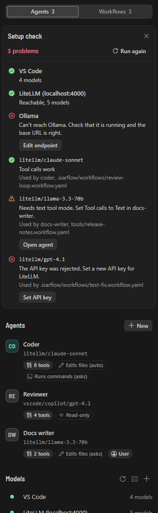

**Isar Flow: Check setup** (Command Palette, the checklist button under **Models** in the sidebar, or the
sidebar's **…** menu) checks every model endpoint (reachable, API key, models) and then tests, one after the
other, every model your workflows use: block models, agent models and fallback models. The report appears at
the top of the sidebar with one row per endpoint and model, the workflows and agents that use each model,
and a button that fixes each problem, such as **Set API key**, **Edit endpoint**, **Add endpoint**, **Open
settings** or **Open <agent>**. Models of an endpoint with a problem are not tested until the endpoint
works. **Run again** checks again; the close button hides the report. Check setup needs a trusted
workspace.

### Model prices

To see what runs cost, list prices per 1 million tokens in `isarFlow.modelPrices`, by model reference:

```jsonc
// settings.json
"isarFlow.modelPrices": {
  "litellm/gpt-4.1": { "input": 2, "output": 8 },
  "litellm/claude-sonnet": { "input": 3, "output": 15 }
}
```

Costs appear on block cards, in the run summary and in a block's run output, only for the models listed.
They have no currency: they are in the unit of your prices. A run that also used unlisted models says how
many had no price.

## 12. Running workflows

### Starting a run

- **Run** in the top bar of the river editor.
- The run button of a workflow in the sidebar.
- The **Run workflow** CodeLens at the top of a `.workflow.yaml` file, the editor title button, or **Run
  workflow** in the file's context menu in the Explorer.
- **Isar Flow: Run workflow** in the Command Palette (runs the active workflow or asks which one).

A workflow runs once at a time; starting it again while it runs is refused. Runs use the workflow as it is
in the editor, unsaved changes included.

Two more ways to run save time while you build a workflow: [Run from here](#run-from-here) continues an
earlier run at a block, and [Simulate](#test-mode-simulate) runs the workflow with mocks, without running
anything.

### Before the run

1. **Workspace Trust**: in Restricted Mode nothing runs ([Restricted Mode](#restricted-mode)); you can still
   simulate.
2. **Validation**: a workflow with errors does not start; Isar Flow names the number of problems and offers
   **Show problems**.
3. **Inputs**: the river editor shows a dialog with one field per input (a larger field for `multiline`
   inputs, a switch for booleans). Other ways of starting ask with input boxes, one per input, and Yes/No
   for booleans. Leave an optional input empty to use its default.
4. **Command confirmation**: see below.

### Command confirmation

Before a workflow runs commands or agents that can change your workspace without asking, Isar Flow lists
them and asks: **Run** (this time) or **Run and remember**.

- **Console commands**: each block's `run` text plus its shell, folder and environment when set, and the
  workflow `env`. Commands appear as written, with their `${{ }}` templates; the values are filled in when
  the block runs. A workflow with `isolation: worktree` lists its setup commands first, as
  `Setup: npm ci`.
- **Agents that act without asking**: agents with `permissions.edits: auto` and the tool `editFile`,
  `applyPatch` or `writeFile`, or `permissions.commands: auto` and the tool `runCommand`
  ([permissions](#permissions)). Each appears once, with the blocks that use it and what it does, for
  example `agent 'coder' in block 'implement': edits files and runs commands without asking`. Agent files
  and inline agents both count; a block's model does not matter. Such agents are listed even when the
  workflow has no console blocks.

When there are both, the commands come first, then the agents under **Agents that act without asking**.
**Run and remember** skips the question for this workflow until anything in the list changes: a command, its
shell, folder or environment, a setup command, or an agent's tools or permissions (for example an agent that only edited
files now also runs commands, or another block uses it). A workflow without such commands or agents runs
without asking. The run uses the agent files as they were when you answered.

`isarFlow.confirmCommands` turns the confirmation off; only your user settings can change it, never a
workspace.

### Restricted Mode

In an untrusted workspace (Restricted Mode) you can open, view and edit workflows and agents, but nothing
runs: starting a run shows a message with a **Manage Workspace Trust** button, and **Try it** asks you to
trust the workspace first. Endpoints that the
workspace's `.vscode/settings.json` defines are ignored; only your user endpoints are used.

You can still [simulate](#test-mode-simulate) workflows: a simulated run runs no commands, calls no models
and changes no files. Secrets aren't available to it, so `${{ secrets.* }}` are empty. Live values of earlier
runs show too ([Live values](#live-values)). **Run from here** needs a trusted workspace.

### During the run

- The canvas shows each block's status, pulses the river toward the running block and counts loop
  iterations. Select a block and open **Run output** for its rendered command or prompt, its output, the
  tools an agent used and its outputs.
- A status bar item shows the running workflow and the elapsed time; select it to open the workflow.
- Console output is mirrored to a terminal tab **Isar Flow: <workflow name>**. Each command starts with
  `▶ <block id>` and ends with its exit code and duration. The terminal is read-only.
- Approval blocks and permission questions wait for your answer ([Approval](#approval),
  [Permissions](#permissions)).

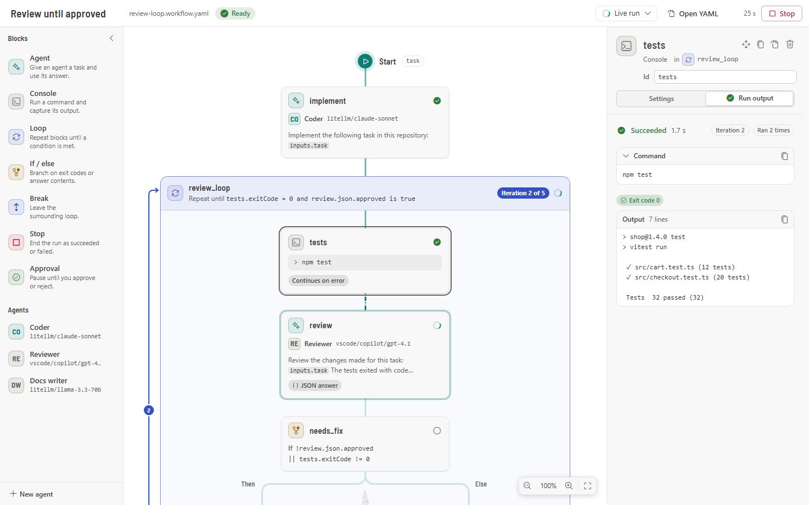

**Stop** (top bar, sidebar, or **Isar Flow: Stop run**) cancels the run: running commands are stopped with
all the processes they started, model requests are aborted, and the run ends as cancelled.

### Time and tokens

After a block finishes, its card on the canvas shows how long it took, the tokens it used and, when the
model has a price ([Model prices](#model-prices)), the cost. Hover the numbers for the turns, the tool calls
and how often the block ran; loop headers say how often the loop ran. All numbers add up every time a block
runs in a loop, and every attempt of a retried block.

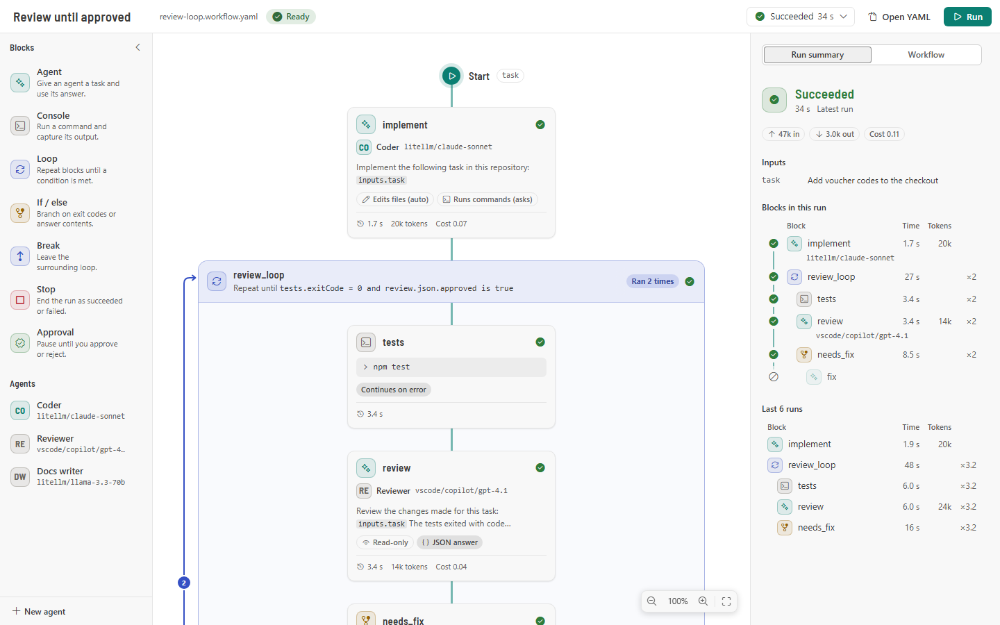

With no block selected, the inspector shows the run summary: a table **Blocks in this run** with each
block's status, time, tokens, model and how often it ran (`×4`), and the totals of the run (time, input and
output tokens, and `Cost 0.04` with "2 models without price" when only some models have prices). Select a
row to select the block. Below it, **Last 20 runs** shows each block's average time, tokens and iterations
over the last 20 finished runs in the history; it appears after two runs.

A block's **Run output** lists time (with the average per execution when it ran several times), input and
output tokens, turns, tool calls, the model and the cost, plus the block's average over the last 20 runs.

### Token budget

`isarFlow.maxTokensPerRun` limits the tokens (input plus output) all agent blocks of a run may use. After
an agent block pushes the total over the limit, the run stops and fails with "Token budget exceeded: used
N of M tokens". `0` means no limit.

### History

Finished runs are kept per workflow (`isarFlow.historyLimit`, default 50) in VS Code's storage for the
workspace. Open them from **Runs** in the top bar, the **Runs** list of the workflow panel, or **Recent
runs** in the sidebar: the canvas then shows that run's statuses, outputs, time and tokens, and its review.
The lists show what happened to a run's changes: **2 to review** while files wait for a decision, or
**3 kept, 1 reverted**. Very large runs are trimmed to 1 MB when they are saved. When a run drops out of the
history, its snapshots, review data and worktree are removed too. Simulated runs are counted separately, so
simulating never pushes a real run (and its review) out of the history.

The lists also mark how a run started: **Resumed** for a run that continued another one (hover it for
"Resumed from tests") and **Simulated** for a simulated run. A failed or cancelled run offers **Run from
<block>** in the **Runs** menu for the block where it stopped ([Run from here](#run-from-here)).

### Reviewing changes

Every run has a safety net. When a run changed files, a notification says so (for example "Review until
approved changed 3 files." with **Review changes**), and the canvas shows a **Review changes** card above the
river, also for past runs:

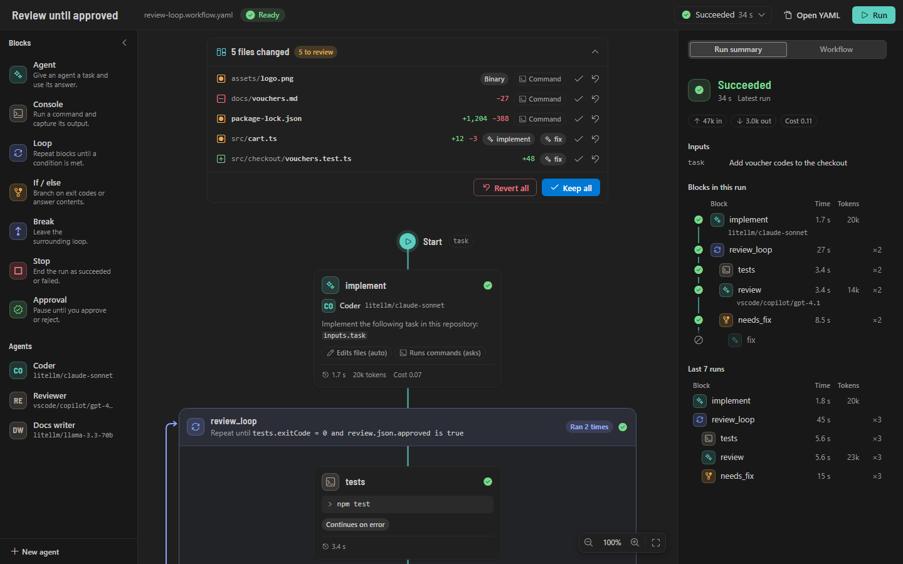

- Each changed file is listed with its status (added, modified or deleted), the added and removed lines and
  the block that changed it. **Command** means a console command (or something else outside the agents)
  changed it. Select a block chip to select the block on the canvas.
- Select a file to open VS Code's diff editor: the file before the run on the left, the file now on the
  right. Binary files can't be compared.
- **Keep** accepts a change. **Revert** puts the file back as it was before the run, byte for byte: an added
  file is deleted, a deleted file is created again. Text files are reverted through VS Code, so open editors
  follow.
- **Keep all** and **Revert all** decide every file that still waits, including files that are not listed
  (the card lists at most 500). **Revert all** sits on the left, away from **Keep all**, and asks first, for
  example "Revert 5 files?"; **Cancel** is the default answer.
- If a file changed again after the run, Isar Flow asks first: "src/app.ts changed after the run. Revert it
  anyway? Your newer changes to it are lost." **Revert all** asks once for all such files: **Revert all
  anyway** or **Skip changed files**.
- When every file is decided, the card folds to a summary such as **3 kept, 1 reverted**.
- If an agent wrote a file that had unsaved changes in an editor, **Revert** brings back that unsaved text
  too. When a console command changed a file before an agent wrote it in the same run, **Revert** goes back
  to the state before the run, not to the state before the agent.
- Agents only edit UTF-8 text files. **Edit file** and **Apply patch** refuse files in other encodings (such
  as Latin-1) instead of damaging characters like é.

How the safety net knows what changed:

- **In a git repository**, Isar Flow takes a snapshot of the workflow's folder before and after each run:
  tracked and untracked files that git does not ignore. It uses a temporary index, so your index, branch,
  stash and working tree are never touched. The snapshots are commits stored as
  `refs/isarflow/runs/<run>/before` and `…/after`, on no branch. They cover agents and console commands.
- **Without git**, only files that agents wrote are listed: the edit journal keeps each file's content from
  before the agent's first write. The card says that changes made by console commands can't be reviewed or
  reverted.
- Originals larger than 2 MB per file or 50 MB per run are kept as git objects when the folder is in a git
  repository; otherwise such a file can't be reverted. Symbolic links can't be reverted either.
- When two runs change the same folder at the same time, the card says "Another run changed this folder at
  the same time, so this list may include its changes."
- If VS Code closes during a run, the after snapshot is taken the first time the review is opened.

Keeping and reverting need a trusted workspace.

### Running in a separate worktree

A workflow can run on a copy of your git repository instead of your files. In the workflow panel, set **Run
in** to **Separate worktree**, or in YAML:

```yaml
isolation: worktree
setup: # optional: commands that run in the worktree before the first block
  - npm ci
```

The run gets its own git worktree in VS Code's storage, checked out at the before snapshot, so uncommitted
work is included. Console blocks, agent tools and context files all work there. Your files stay untouched
until you decide in the review card: **Keep** copies a change into your workspace (asking first if the
workspace file changed during the run), **Revert** drops it. Once every file is decided, the worktree is
removed.

- Setup commands run one after the other in the worktree, shown in the run's terminal as `▶ setup: npm ci`.
  When one fails, the run ends: "Setup command "npm ci" failed with exit code 1. See the terminal for its
  output." Setup commands are part of the command confirmation and run as written: `${{ }}` templates
  are not filled in.
- A worktree needs git: "Isolation "worktree" needs a git repository. Run git init in <folder>, or set
  isolation to workspace."
- Files that setup commands create and git does not ignore show up in the review. `node_modules` and most
  build output are usually ignored.
- Switching **Run in** back to **Workspace** also removes the setup commands, after you confirm it.

### Run from here

Changed a block late in a workflow? **Run from here** continues a finished, failed or cancelled run at a
block, so you don't wait for everything before it again.

- On the canvas, show the run (the one that just ended, or a past run from **Runs**), right-click a block
  and choose **Run from here**. The block's **Run output** in the inspector has the same button.
- In the **Runs** menu, a failed or cancelled run offers **Run from <block>** for the block where it stopped.
- In the YAML, right-click inside a block and choose **Run from here**, or run **Isar Flow: Run from here**:
  it continues the newest run that wasn't simulated at the block under the cursor, or asks for the block.
  It shows the same warnings as the dialog (see below) and asks before it starts.

What runs and what is reused:

- Blocks before the chosen block, in the order of the file, don't run again. Their results from that run
  are reused: templates like `${{ steps.tests.output }}` read them, and their cards show **Reused** with no
  time or tokens.
- A loop that contains the block continues at the iteration where the block last ran, without checking its
  condition for that iteration. If you lowered its `maxIterations` below that iteration, the iteration still
  runs, then the loop stops as it does at its limit ([Loops](#9-loops)).
- An If that contains the block takes the branch with the block, whatever its condition says now.
- From the chosen block on, everything runs normally, including the rest of the loop and the blocks after it.
  Blocks after the chosen one inside a continued loop keep their results from that iteration until they run
  again, and show **Reused** until then.
- The run gets the inputs of that run. When the workflow has inputs, the dialog fills them in and you can
  change them.
- Commands are confirmed as for any run ([Command confirmation](#command-confirmation)), and the workspace
  must be trusted.

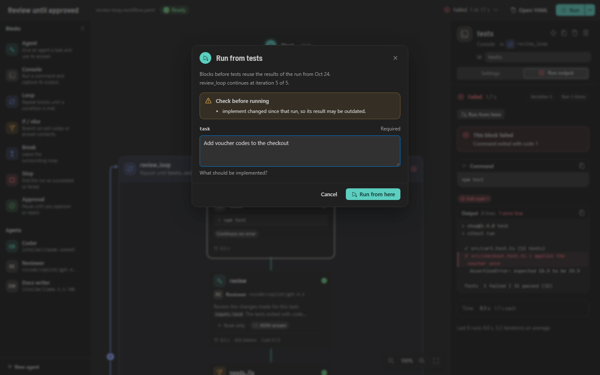

Before the run starts, the dialog says which results are reused and where loops continue. Under **Check
before running** it warns when:

- blocks before the chosen one changed since that run (Isar Flow compares each block's YAML), so their
  results may be outdated. Runs saved by older versions of Isar Flow can't be checked;
- blocks have no result in that run, so expressions that read them get empty values;
- saved results were shortened to fit the history, or contain a secret: blocks after them get `••••••`
  instead of the value;
- a loop is past its new limit, or an If took the other branch in that run;
- agents with `session: continue` start a new conversation (conversations aren't saved with runs);
- the workflow runs in a [separate worktree](#running-in-a-separate-worktree): the new worktree starts from
  your workspace as it is now, not from where that run stopped;
- you reverted files of that run: the blocks from the chosen one on see the files as they are now.

Without inputs and warnings, the run starts at once. The new run is a run of its own: the Start marker says
**Resumed from <block>**, the history marks it **Resumed**, and its time, tokens, cost and token budget count
only the blocks that ran.

Run from here isn't offered while the workflow runs, for simulated runs (run the workflow, then run from a
block), in Restricted Mode, or while the workflow has problems. A run that dropped out of the history can't
be continued ("That run is no longer in the history. Run the workflow instead."), and neither can a block
that was removed from the workflow.

### Live values

After a run, templates show what they evaluated to.

- **Canvas:** hover a `${{ … }}` template on a block card. The card shows its value in the run on the canvas
  (**This run**), or in the newest run when the canvas shows none (**Last run**), with the run's status and
  time and the value's type.
- **Inspector:** under a field with templates, open **Values from the last run** to see the value of each
  template; **Copy** copies one.
- **Conditions:** If and Loop headers and the summary of the condition builder show **Last run: true** or
  **Last run: false**.
- When the newest run was a simulation, the labels say so: **Last simulation: true**, **Values from the last
  simulation**, and **This simulation** while a simulated run is shown, so mock values are never mistaken for
  real ones.
- **YAML:** rest the pointer on a template in a `.workflow.yaml` file. The hover shows its value in the
  running run, or else in the newest run, for example **Value in the last run** (failed, 4 min ago).

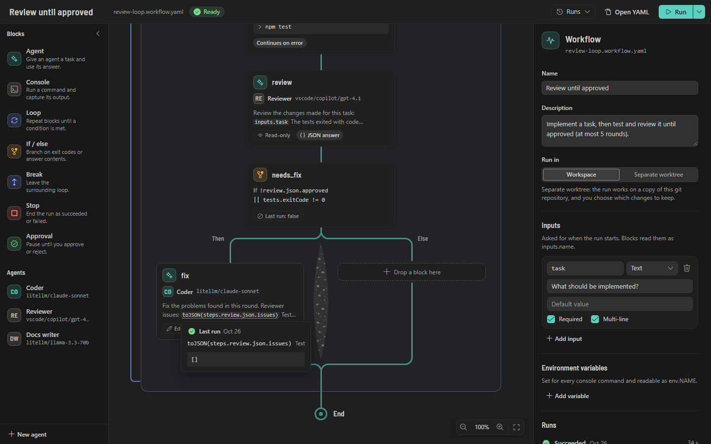

Values longer than 2 KB are cut and marked as shortened, and secrets show as `••••••`. Environment values are
never saved with runs, so `env.*` shows no value. `loop.*` shows the loop's last iteration in that run. Live
values only read saved runs, so they also work in Restricted Mode.

### Test mode (Simulate)

**Simulate** runs a workflow without running anything: console commands don't run, models aren't called,
files don't change, and approvals are answered automatically. Every block gets its result from mocks you
write, so you can check loops, conditions and templates in seconds and without tokens.

Start a simulation from the arrow next to **Run** (**Simulate**; it asks for the inputs like Run), the
**Simulate** CodeLens above the YAML, **Simulate workflow** in the Explorer context menu, Alt-click on the
Run button in the editor title, or **Isar Flow: Simulate workflow**. Simulate also works in Restricted Mode: the Restricted Mode banner has a **Simulate** button. Simulate never
saves the workflow; it simulates the text as it is, unsaved edits included.

**The simulation file.** Mocks live in `.isarflow/simulations/<workflow file name>.sim.yaml` in the workspace
folder, for example `.isarflow/simulations/review-loop.sim.yaml` for `review-loop.workflow.yaml`, wherever
the workflow is in the folder. (A workflow outside every workspace folder uses `.isarflow/simulations` next to
it, and an existing `.sim.yml` is used when there is no `.sim.yaml`.) Two workflows with the same file name in
one folder share the file. A file for the review loop of the examples:

```yaml
version: 1
approvals: approve # or reject: how approval blocks without mocks are answered
blocks:
  tests:
    - exitCode: 1
      output: 1 failed
    - exitCode: 0
      output: 32 passed
  review:
    - json: { approved: false, issues: [Add a test for empty codes] }
    - json: { approved: true, issues: [] }
  fix:
    - text: Added the missing test.
```

- Each block id under `blocks:` has a list of results. Each call of the block takes the next one, and the last
  one repeats. Retries and loop rounds count as calls, so the review loop above fails its tests in round 1
  and passes in round 2.
- Console blocks use `exitCode` and `output`. Agents use `text`, or `json` for agents with JSON answers (text
  that contains JSON works too). Approvals use `approved` and `comment`. `error` fails the call with that
  message, on any block:

  ```yaml
  blocks:
    approve_release:
      - approved: false
        comment: Not this week
    publish:
      - error: The registry is not reachable.
  ```

- Blocks without mocks get defaults: console blocks exit with 0 and print nothing, agents answer
  `(simulated answer)`, agents with JSON answers answer sample JSON built from their JSON fields, and
  approvals are approved (rejected with `approvals: reject`).
- With the YAML extension, the file is checked as you type. The workflow editor also warns about block ids
  that aren't in the workflow, mocks for loop, if, break and stop blocks, fields of another block type, and
  JSON that doesn't match the block's JSON fields.
- While the file has errors, Simulate doesn't start: "Fix .isarflow/simulations/review-loop.sim.yaml before
  simulating: …" with **Open simulation file**. Common mistakes get a hint, for example block ids at the top
  of the file ("Put the mocks of block tests under blocks:") or a field of another block type.

**Editing mocks in the inspector.** Select a console, agent or approval block and open **Simulation**. It
lists the results Simulate uses for the block, one per call: an exit code and output for console blocks, an
answer for agents (a new result of a JSON agent starts with sample JSON), **Approve** or **Reject** and a
comment for approvals. **Add result** adds one; move or remove results with the buttons next to them, and turn
on **Fail this call** to fail a call with an error message. Changes are saved to the simulation file as you
type, comments in the file stay. **Open simulation file**, or **Edit simulation mocks** in the menu of the
arrow next to **Run**, opens the file (created from a short template when it doesn't exist yet). Renaming a
block on the canvas moves its mocks too. While the file has errors, the section only offers to open it.

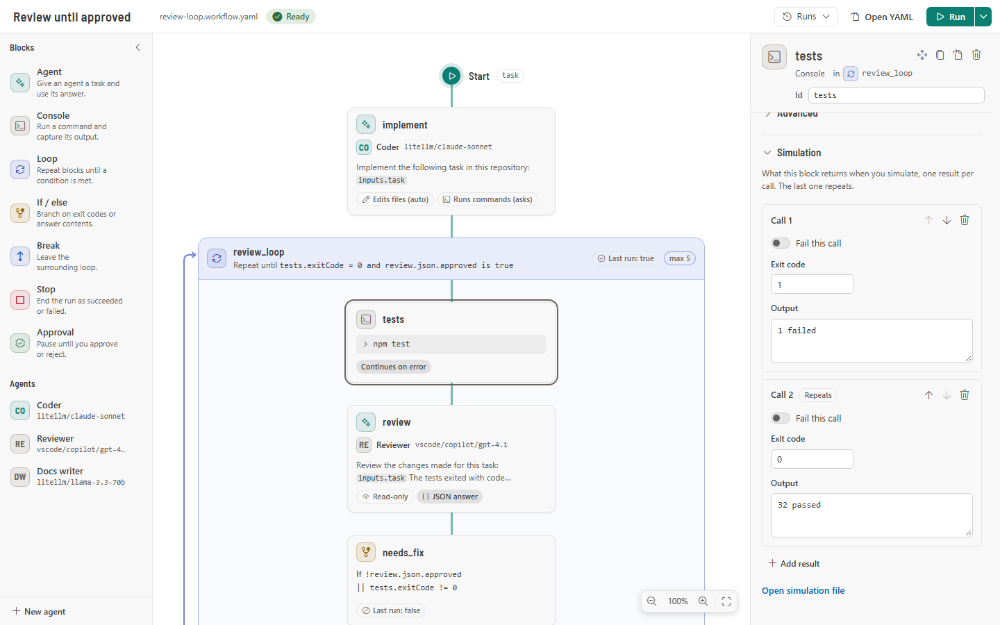

**Simulated runs** are easy to tell apart from real runs: they use the blue enzian color and a beaker icon
instead of the run colors, and the canvas pins a **Simulated run** banner (**Simulating** while it runs) with
an **Edit mocks** link. Blocks still run one at a time, and the run output of a console
block says which result it used, for example "Simulated: result 1 of 2." They ask for no command
confirmation, take no snapshot, and show no review, notification or terminal output; the status bar says
**<workflow> (simulated)**. They are saved to the history and marked **Simulated** on the Start marker, in
the **Runs** menu, the run history and the sidebar. Their cards show no time or cost, they use no tokens, and
they are left out of the averages of the last 20 runs. A simulated run can't be continued with Run from here.

## 13. Secrets

Run **Isar Flow: Set workflow secret**, enter a name (letters, digits and `_`, not starting with a digit)
and the value. Workflows read it as `${{ secrets.NAME }}`. To delete a secret, set it again with an empty
value.

- Values are kept in VS Code's secret storage, never in settings or workflow files.
- Every stored secret is available to every workflow you run in a trusted workspace.
- Values of 4 or more characters are replaced with `••••••` in run events, the run view, the terminal, the
  history and approval prompts.
- Masking only hides values from what Isar Flow shows. A workflow can still pass them to commands and
  models, so review workflows from others before running them.

Pass secrets to commands through `env` rather than in the command line:

```yaml
- id: publish
  type: console
  env:
    NPM_TOKEN: ${{ secrets.NPM_TOKEN }}
  run: npm publish
```

## 14. Settings

| Setting                       | Default | Description                                                                                                                                                                                                |
| ----------------------------- | ------- | ---------------------------------------------------------------------------------------------------------------------------------------------------------------------------------------------------------- |
| `isarFlow.providers`          | `[]`    | OpenAI-compatible model endpoints ([Models](#11-models)). Ignored from workspace settings in Restricted Mode.                                                                                              |
| `isarFlow.vscodeModels`       | `true`  | Offer the language models available in VS Code (for example GitHub Copilot).                                                                                                                               |
| `isarFlow.defaultShell`       | `auto`  | Shell for console blocks without `shell` and for the agent tools `runCommand` and `gitDiff`: `auto`, `pwsh`, `powershell`, `cmd`, `bash` or `sh`.                                                          |
| `isarFlow.maxTokensPerRun`    | `0`     | Stop a run when its agents used more tokens than this. `0` means no limit.                                                                                                                                 |
| `isarFlow.confirmCommands`    | `true`  | Ask before running a workflow whose console commands, or agents that act without asking, you have not approved yet. Only your user settings can turn this off.                                             |
| `isarFlow.historyLimit`       | `50`    | Runs kept per workflow (1–500). The snapshots, review data and worktrees of runs dropped from the history are removed too.                                                                                 |
| `isarFlow.agentContextTokens` | `24000` | Context size in tokens for models that don't report one (at least 2000). Agent conversations are summarized at 70 % of it ([Long conversations](#long-conversations)).                                     |
| `isarFlow.modelPrices`        | `{}`    | Prices per 1 million input and output tokens by model reference, for example `{ "litellm/gpt-4.1": { "input": 2, "output": 8 } }`. Costs are shown only for listed models ([Model prices](#model-prices)). |

## 15. Commands

All commands are in the Command Palette under **Isar Flow**.

| Command                  | What it does                                                               |
| ------------------------ | -------------------------------------------------------------------------- |
| New workflow             | Asks for a name and a template and opens the new workflow.                 |
| New agent                | Asks for a name, a starter and the scope and opens the new agent.          |
| Run workflow             | Runs the active workflow, or asks which one to run.                        |
| Simulate workflow        | Simulates the active workflow with its mocks, or asks which one.           |
| Run from here            | Continues the newest run at the block under the cursor, or asks for one.   |
| Open simulation file     | Opens the workflow's `.sim.yaml`, created from a template when needed.     |
| Stop run                 | Stops the running workflow, or asks which one when several run.            |
| Open in Isar Flow editor | Opens a workflow or agent YAML file in the river or agent editor.          |
| Open YAML                | Opens the YAML of the workflow or agent beside its editor.                 |
| Add model endpoint       | Adds an OpenAI-compatible endpoint.                                        |
| Edit model endpoint      | Changes an endpoint's URL, name, key or extra models; tests or removes it. |
| Remove model endpoint    | Removes an endpoint and its stored API key.                                |
| Set provider API key     | Stores or removes the API key of an endpoint.                              |
| Test model endpoint      | Lists an endpoint's models once and reports the result.                    |
| Refresh models           | Lists the models of all providers again.                                   |
| Test model               | Asks a model for a tool call and a JSON answer and reports the result.     |
| Check setup              | Checks every endpoint and tests the models your workflows use.             |
| Set workflow secret      | Stores or deletes a secret for `${{ secrets.NAME }}`.                      |
| Show log                 | Opens the **Isar Flow** output channel.                                    |

## 16. Security

Isar Flow runs commands and lets models act in your workspace. Read this before running workflows or
agents written by others.

- **Workspace Trust.** Nothing runs in Restricted Mode. The host checks trust before every run and every
  Try it.
- **Templates are not escaped.** Values from `${{ inputs.* }}`, `${{ steps.<id>.output }}` and other
  outputs (model answers included), `${{ env.* }}` and `${{ secrets.* }}` are pasted into a console
  block's `run`, `cwd` and `env` as they are. The confirmation dialog shows the template, not the rendered
  command. Do not put user input or agent output into command lines: pass it through `env` and quote it in
  the shell:

  ```yaml
  - id: commit
    type: console
    shell: bash
    env:
      MESSAGE: ${{ steps.draft.text }}
    run: git commit -m "$MESSAGE" # pwsh: git commit -m $env:MESSAGE
  ```

- **The confirmation lists what can change your workspace without asking**: console blocks (run text,
  shell, folder and environment, plus the workflow environment) and agents with `permissions.commands` or
  `permissions.edits` set to `auto` and a matching tool ([Command confirmation](#command-confirmation)).
  Once you run such a workflow, those agents run the commands and edits the model chooses without asking,
  and a workflow from a repository can use such agents. Read the list before running workflows written by
  others. Try it always asks: it treats `auto` as `ask`.
- **Secrets.** Every stored secret is available as `secrets.*` to every workflow you run in a trusted
  workspace. Values of 4 or more characters are masked in run events, the terminal, history and approval
  prompts, but a workflow can still pass them to commands or models.
- **Workspace endpoints.** Trusting a workspace lets its `.vscode/settings.json` define model endpoints
  (`isarFlow.providers`). A workspace endpoint with the same id as one of yours replaces it and receives
  your stored API key. In Restricted Mode only your user endpoints are used.
- **Agent tools stay inside the workflow's own workspace folder.** Paths are checked after resolving
  symbolic links, junctions and Windows 8.3 short names (for edits again right before writing, after you
  answered the permission question), and nothing inside `.git` can be written. Within
  that folder agents can read every file, including `.env` files, and send it to the model provider.
  `gitDiff` counts as a read tool, so it never asks, and it runs git with the repository's git
  configuration.
- **Context files** (`context.files`) are attached only when their real path is inside the workflow's
  folder; links pointing elsewhere are skipped with a note.
- **Processes are not sandboxed.** Console commands and agent commands run with your VS Code environment,
  including any credentials in environment variables. Only `ELECTRON_RUN_AS_NODE` and
  `ELECTRON_NO_ATTACH_CONSOLE` are removed.
- **Webviews are UI only.** The host checks Workspace Trust and confirms console commands before every
  run, but a compromised webview could still start runs whose commands you already approved and answer
  approval blocks of the workflow it shows. In the sidebar it could delete agent files (to the trash) and
  remove endpoints, which are confirmed only inside the webview.
- **Snapshots stay local.** In a git repository, run snapshots are commits under `refs/isarflow/runs/`, on no
  branch. A normal `git push` does not send them, but `git push --mirror` or a push of all refs would. They
  contain the files of the folder as they were before and after each run (only files git does not ignore),
  and are removed with the run history. Snapshot commands run without your git hooks and never sign.
- **Review is not a sandbox.** Reverting restores files after the run; it does not undo what commands did
  elsewhere (network calls, other folders, databases). A worktree run keeps your files untouched, but its
  commands still run with your permissions.
- **Runs always end.** Loops need `maxIterations`, agents have `maxTurns`, blocks can have a `timeout`, and
  the token budget stops expensive runs.
- **Model output is shown as text** and is never rendered as HTML.

## 17. Troubleshooting

Start with **Isar Flow: Show log**: activation, model discovery, runs and failed blocks are logged there.

| Problem                                                                 | What to do                                                                                                                                                                                    |
| ----------------------------------------------------------------------- | --------------------------------------------------------------------------------------------------------------------------------------------------------------------------------------------- |
| **Run** is disabled                                                     | Hover it to see why: the workspace is not trusted, the YAML cannot be read, there are problems, or the workflow has no blocks.                                                                |
| "Fix N problems … before running"                                       | Select **Show problems**. Errors block the run, warnings do not.                                                                                                                              |
| A model is missing from the pickers                                     | Run **Refresh models** or **Test model endpoint**. Check the base URL (with or without `/v1`) and the API key. Servers that cannot list models need `models` in the setting.                  |
| "Model '…' is not available" warning                                    | The model is not in the current model list. Refresh the models or pick another one.                                                                                                           |
| "Isar Flow may not use the VS Code model …"                             | Allow Isar Flow when VS Code asks, or under **Accounts → Manage Language Model Access**.                                                                                                      |
| "Agent '…' not found"                                                   | Create `.isarflow/agents/<id>.agent.yaml` (or a user agent) with that id, or pick another agent. Agent files must be saved.                                                                   |
| A command works in your terminal but not in a workflow                  | Set `shell` on the block or change `isarFlow.defaultShell`. With `bash` on Windows, install Git for Windows.                                                                                  |
| Wrong characters in console output                                      | Output is read as UTF-8, and PowerShell and cmd are switched to UTF-8 for each command. A program that still writes another encoding shows wrong characters; check its own encoding options.  |
| The agent's answer "is not valid JSON for the expected shape"           | Describe the JSON in the prompt or system prompt, simplify `output.schema`, or use a stronger model.                                                                                          |
| "The agent used all N turns …"                                          | Raise `maxTurns` or split the task into several blocks.                                                                                                                                       |
| A loop fails with "reached its limit of N iterations"                   | Raise `maxIterations`, check the condition, or set `onMaxIterations: continue`.                                                                                                               |
| `steps.x.json` is empty                                                 | Set `output.format: json` on block `x`, or read `steps.x.text`.                                                                                                                               |
| A value in a condition or prompt is empty                               | The block has not run yet at that point, or it is in the other branch of an If. The inspector and the Problems view warn about such references.                                               |
| "The YAML can't be read"                                                | Select **Show in YAML** and fix the line the banner names. Quote values with `: `, ` #` or a leading `${{` inside `{ }`.                                                                      |
| Nothing runs, "Workflows don't run in Restricted Mode"                  | Trust the workspace (**Manage Workspace Trust**) if you trust its content.                                                                                                                    |
| Agent tools say "Agent tools need an open folder"                       | Open a folder; agent tools work inside a workspace folder only.                                                                                                                               |
| An agent writes tool calls as text, or never calls a tool               | Run **Test model**. A model that needs text tool mode works with **Tool calls** on **Automatic** after the test, or set **Tool calls** to **Text in the prompt** ([Tool calls](#tool-calls)). |
| "The model wrote tool calls that could not be read twice"               | Set **Tool calls** to **Text in the prompt** in the agent, or use a model with native tool calling.                                                                                           |
| The log warns that the conversation needs more than 70 % of the context | Attach fewer or smaller context files, or use a model with a larger context. If the model supports more, raise `isarFlow.agentContextTokens`.                                                 |
| "Isolation "worktree" needs a git repository"                           | Run `git init` in the folder (and commit), or set **Run in** back to **Workspace**.                                                                                                           |
| "Setup command … failed"                                                | The terminal of the run shows the command's output. Fix the command, or run it once in your own terminal inside the repository to check it.                                                   |
| The review card doesn't list a file a command changed                   | Without git, only files that agents wrote are listed. Run `git init` in the folder to cover console commands too.                                                                             |
| A file can't be reverted                                                | Its state before the run wasn't saved: it was larger than 2 MB without git, or it is a symbolic link. Restore it from version control.                                                        |
| Check setup reports an endpoint as unreachable                          | The endpoint didn't answer within 30 s. Check that the server runs and the base URL is right, then select **Run again**.                                                                      |
| **Run from here** is disabled                                           | Hover it to see why: no finished run is shown, the workflow is running or has problems, the run was simulated, or the workspace is not trusted.                                               |
| "That run is no longer in the history"                                  | The run dropped out of the history (`isarFlow.historyLimit`). Run the whole workflow, then run from a block of the new run.                                                                   |
| "Fix … before simulating"                                               | Select **Open simulation file** and fix the line the message names. Each block id needs a list of results (`- exitCode: 0`), not a single result.                                             |
| A simulated block uses the wrong result                                 | Each call takes the next result and the last one repeats; retries and loop rounds count as calls. Check that the block id under `blocks:` matches the block (the editor warns otherwise).     |
| A live value says the block has no result                               | The block didn't run in that run, or it is in the other branch of an If. Run the workflow again; hovers show the newest run.                                                                  |
